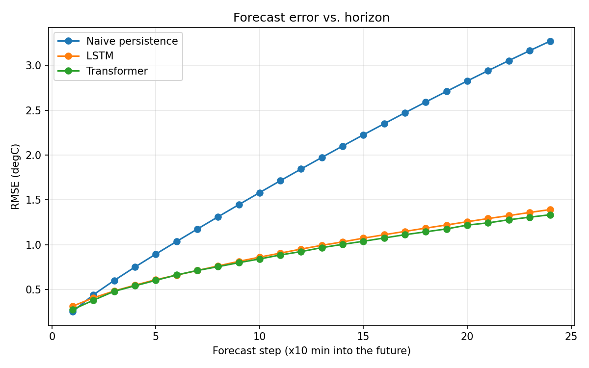
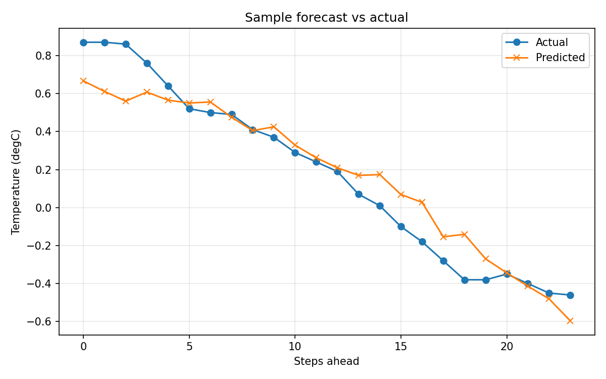
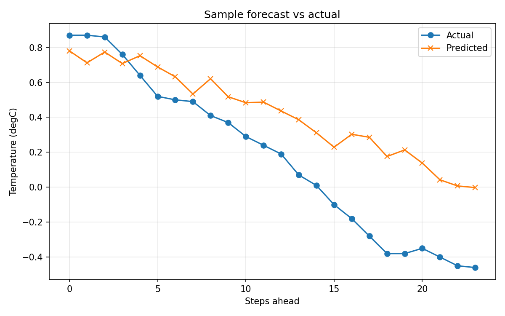

# Multivariate Time-Series Forecasting

Forecasts temperature 4 hours ahead from 14 multivariate sensor variables,
using a 24-hour lookback window. Compares a naive persistence baseline
against an LSTM and a lightweight Transformer encoder.

Dataset: Jena Climate 2009-2016 (Max Planck Institute for Biogeochemistry),
14 weather variables recorded every 10 minutes.

## Results

Both deep models roughly halve the forecast error versus a naive persistence
baseline, with the advantage widening the further ahead they predict.

| Model | Overall RMSE (deg C) | Overall MAE (deg C) |
|-------|:--------------------:|:-------------------:|
| Naive persistence (baseline) | 1.864 | 1.383 |
| LSTM | 0.934 | 0.676 |
| Transformer | **0.906** | **0.657** |

The Transformer edges the LSTM slightly, but they are effectively tied - a
realistic outcome, since Transformers usually need larger datasets to
clearly outperform recurrent models.

**Forecast error vs. horizon** - at the first step (10 minutes ahead) the
naive baseline is as good as the deep models; from step 2 on the deep models
are clearly better, and the gap grows with the forecast horizon:



**Sample forecasts** (predicted vs. actual over the 4-hour horizon):




## Setup

```bash
pip install -r requirements.txt
python forecast.py
```

The script downloads the dataset automatically on first run (~13.5 MB zip,
~420,000 rows) from Google's public TensorFlow datasets bucket, and caches it
in `data/`. No account or API key needed.

Training on the full dataset (15 epochs, both models) takes roughly:
- **CPU only**: ~4 minutes per epoch, so ~1-2 hours total for both models
- **GPU**: 5-10 minutes total

For a fast first run to confirm everything works, lower `EPOCHS` to 2-3 at
the top of `forecast.py`.

## Method

1. **Feature engineering**: converts wind speed + direction into (x, y)
   vector components (raw degrees are misleading near 0/360 deg), and encodes
   time-of-day / time-of-year as sin/cos pairs so cyclical patterns are
   visible to the model.
2. **Chronological split**: 70% train / 20% val / 10% test, in time order
   (never shuffled across the split - shuffling time series before splitting
   leaks future information into training).
3. **Windowing**: each example is 24 hours of all engineered features, paired
   with the next 4 hours of temperature to predict.
4. **Three models compared**: naive persistence, a 2-layer LSTM, and a
   Transformer encoder with multi-head self-attention and positional encoding.
5. **Evaluation**: RMSE and MAE in real degrees Celsius, reported per forecast
   step so you can see how error grows with the horizon.
6. **Training curves**: the training and validation loss of every epoch is
   saved to `results/loss_history_<model>.csv` and drawn in
   `results/loss_curves.png`; the epoch with the lowest validation loss is the
   one kept.

## Files

```
forecast.py          Main training / evaluation script
test_pipeline.py     Smoke test on synthetic data (fast sanity check)
requirements.txt     Dependencies
results/             Generated plots and per-epoch loss CSVs (committed)
data/                Dataset cache (git-ignored, auto-downloaded)
*.pt                 Trained model weights (git-ignored, regenerated on run)
```

## Extending this further

- Multi-target forecasting (predict several variables at once)
- Attention-weight visualization for the Transformer
- Quantile/probabilistic forecasting instead of point forecasts
- A classical statistical baseline (ARIMA/SARIMA) alongside naive persistence
